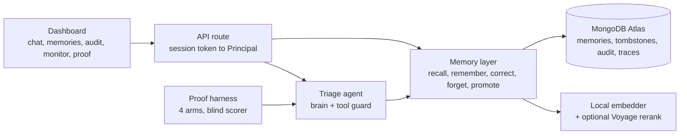
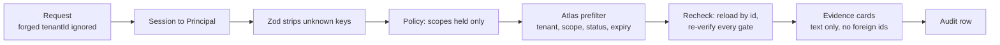
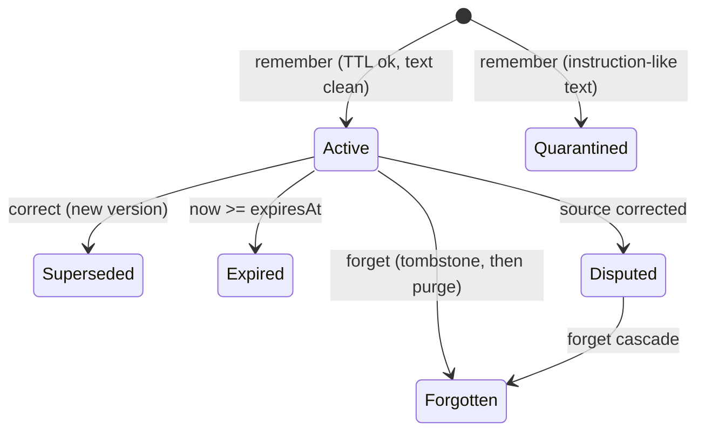
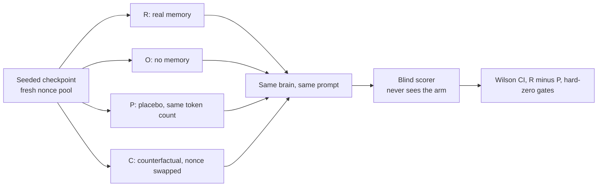

# Governed Memory Layer

Memory for an AI agent that someone can govern. An incident-triage agent remembers fixes between incidents, but every read and write passes through one policy layer. The model proposes actions. Code decides what it may remember, recall, forget, and run.

The demo agent triages service alerts (for example, a 5xx spike caused by a saturated cache pool). It recalls a past fix, restarts the pool, and learns from the result.

Full diagrams (8, with sequences and component tables): open [`docs/architecture-diagrams.html`](docs/architecture-diagrams.html) in a browser.

Demo videos: a 1 minute and a 3 minute walkthrough. See [Demo videos](#demo-videos).

## How it works



One alert, one turn:

1. **Recall.** The agent asks the memory layer for precedent for this service, version, and environment.
2. **Decide.** The brain (rule brain or Claude) proposes an action and cites the memory ids it used.
3. **Guard.** Code checks the tool is on the allowlist, args are valid, cited ids really came back, and the memory is still valid right now.
4. **Act and learn.** The tool runs. A verified new fix is remembered. A memory-guided action that failed makes the agent forget that memory.

Every operation, including denials, writes an audit row (ids and hashes only, never raw text). Every step writes an append-only trace event.

## How it answers the three questions

### 1. How do you keep one client's or team's memory from leaking into another's?

Identity comes from the session, never from the request. The database query is built from that identity, and every vector hit is rechecked.



Limit: this is application-enforced logical isolation in a shared collection. Zero leaks in N trials is evidence, not proof of impossibility.

### 2. How does the agent fix or drop a memory that turns out wrong or expired?

Expiry is a gate at read time, not a cleanup job. Wrong memories are corrected into a new version or forgotten with a tombstone, and children derived from them go too.



Only `Active` memories are ever recalled. The agent also self-corrects: if a restart based on memory does not fix the incident, it calls `forget` on that memory (policy still decides). The next recall comes back empty, so it investigates and learns the real fix.

Limit: forgetting means the agent cannot recover the memory from these stores. Atlas backups and outside copies are out of scope.

### 3. How do you prove a memory changed the agent's behavior and didn't just fill the prompt?

Fork the same incident four ways. Only the memory block differs.



R should succeed. O and P should fail, since a random nonce cannot be guessed and filler does not help. C should flip to the other pool and change nothing else. Results are reported as counts with intervals, for example `0 / 300`.

Limit: the deterministic rule brain proves plumbing and governance, not model behavior. Model numbers come only from the LLM brain, and only if it was run. The proof shows that changing memory changes the action, not the model's internal mechanism.

## Install

Requirements: Node 20+, a MongoDB Atlas cluster (vector search is needed for recall), and optionally an Anthropic key and a Voyage key.

```bash
npm install
cp .env.example .env      # then fill in the values below
npm run bootstrap         # create collections, validators, vector index
npm run doctor            # check collections, vector index, change streams
npm run seed              # seed demo principals and memories
npm run dev               # dashboard at http://localhost:3000
```

`.env` values:

| Variable | Needed | Purpose |
|---|---|---|
| `MONGODB_URI`, `MONGODB_DB` | yes | Atlas connection and database name |
| `ANTHROPIC_API_KEY` | no | LLM brain. Without it the app uses the rule brain, which cannot learn |
| `VOYAGE_API_KEY` | no | Rerank of recall candidates (ranking only) |
| `VONAGE_*` | no | SMS alerts. All four must be set, otherwise alerts are off |

Embeddings run locally (`@xenova/transformers`), so no outside service sees memory text. The model downloads on first use.

## Demo videos

Both videos were generated with AI tools. Click a preview to watch on YouTube.

**Short demo (about 1 min).** The running app with a voiceover: tech stack, live chat, and how each part answers the three questions.

[](https://youtu.be/xOWCk7wjgU8)

**Detailed demo (about 3 min).** An animated walkthrough of what the project is, the architecture, and how it answers each question in depth.

[](https://youtu.be/WvUPCApNzdU)

Notes:
- The short demo's voiceover uses a local text-to-speech voice, so no text left the machine.
- The app screens in the short demo are real recordings of the app running in demo mode with the seeded demo users.
- The proof numbers shown in the short demo came from the deterministic rule brain over 20 seeds. They prove plumbing and governance, not model behavior.

## Commands

| Command | What it does |
|---|---|
| `npm test` | Run the full test suite (uses in-memory fakes, no network) |
| `npm run typecheck` | `tsc --noEmit` |
| `npm run reset` | Reset the demo database |
| `npm run build` | Production build |

## Project layout

| Path | Contents |
|---|---|
| `src/core` | Identity, policy, remember, recall, lifecycle, audit |
| `src/agent` | Triage loop, brains, tool guard, scenarios, tracing |
| `src/eval` | Four-arm proof harness, scorers, statistics |
| `src/db` | Atlas stores, vector index, trace feed, metrics |
| `src/fakes` | In-memory stores used by tests |
| `src/app` | Next.js dashboard and API route |
| `src/contracts` | Shared types between app and storage |
| `tests` | core, agent, proof, db, security, app |
| `docs` | Diagrams, demo script, handoff notes |
| `video` | Source for the two demo videos |

## Honest limits

- Isolation is application-enforced logical isolation, not a proof of impossibility.
- Forgetting covers these stores only, not Atlas backups or outside copies.
- The deterministic brain proves plumbing and governance, not model behavior.
- The proof shows memory changes the action under control, not the model's internal mechanism.
