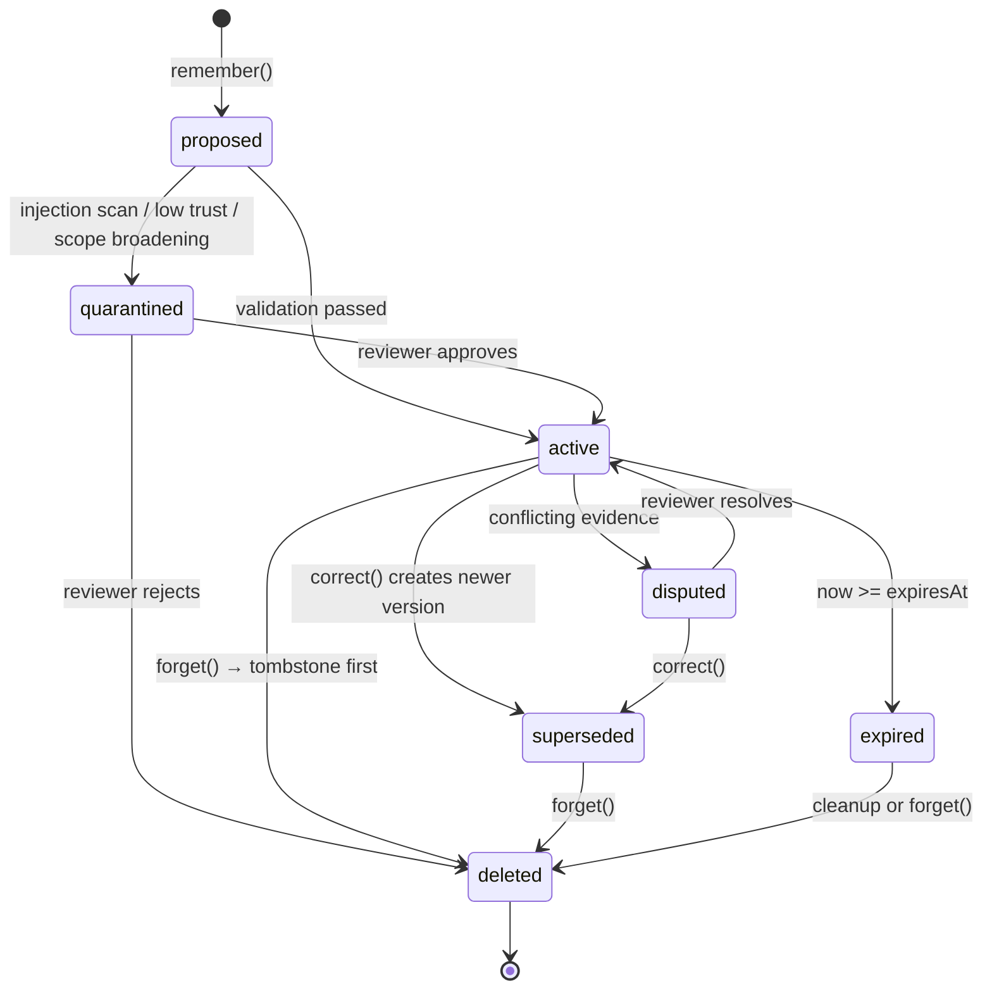

# Governed Memory Layer — Hackathon Implementation Plan

> **For agentic workers:** REQUIRED SUB-SKILL: Use superpowers:subagent-driven-development (recommended) or superpowers:executing-plans to implement this plan task-by-task. Steps use checkbox (`- [ ]`) syntax for tracking.

**Goal:** Build a generic, permission-checked, expiring, correctable, forgettable memory layer on MongoDB Atlas + Atlas Vector Search that any agent can plug into, with an incident-triage demo agent, a proof harness showing memory changed the agent's action, and a dashboard.

**Architecture:** One TypeScript repo. A `memory-core` library exposes `remember / recall / correct / forget` (+ `promote`). Every call goes through an identity + policy gate, a single data-access module that injects tenant filters, an Atlas `$vectorSearch` with a server-built prefilter, and an authoritative recheck against the source document. A demo agent calls only that API. A proof harness replays the same incident under controlled memory conditions and diffs the agent's structured action. A Next.js dashboard shows memories, audit decisions, and proof results.

**Tech Stack:** TypeScript, Node 20+, MongoDB Atlas (M0 free tier is enough) with Atlas Vector Search, official `mongodb` driver, `zod`, `semver`, in-process embeddings via `@xenova/transformers` (MiniLM, 384 dims, no external service), Vitest, Next.js (dashboard + API routes). No third-party services. The demo agent's "brain" is a deterministic rule engine by default; an LLM brain is an optional switchable provider.

**Spec:** Hackathon brief "Memory You Can Govern" (3 questions) and this document. Supersedes the earlier EcoCharge-centric plan.md.

## Global Constraints

- Every memory read goes through `MemoryRepo`; no other module may touch a Mongo collection directly (enforced by a test that greps the source tree).
- `tenantId` is never taken from caller input or prompt text; it comes from the server-resolved `Principal`.
- Expiry is a hard gate: eligible only if `now < expiresAt` (at `now == expiresAt` it is ineligible).
- Time comes from an injected `Clock`; nothing calls `Date.now()` outside the `Clock` implementations.
- Embedding model pinned: `Xenova/all-MiniLM-L6-v2`, 384 dimensions, cosine similarity, vectors L2-normalized.
- Fail closed: unknown principal, missing policy, invalid time, or failed recheck → deny, never broaden.
- Audit rows hold IDs, hashes, decisions and reason codes only — never raw memory text.
- Zero leaks, zero expired-memory uses, zero forgotten-memory recoveries are hard gates; reported with the sample count (no "impossible" claims).
- Only `src/db` and `scripts` may import the `mongodb` driver; `src/core`, `src/agent`, `src/eval`, `src/app` work through the interfaces in `src/contracts/contracts.ts`.
- Audit rows and trace events hold ids, hashes and reason codes only — no raw memory text, no secrets.
- `TraceStore` is append-only (no update or delete method); trace failures never stop the agent but mark the trace `complete: false`.

## Review Focus

- Wrong-version fix (`<2.0.0` fix, alert on `2.3.1`): excluded by the applicability check even if it is the closest semantic hit. Tested in B3.
- Same symptom, different service (near-duplicate text): not adopted. Tested in B3.
- Vector index lag (memory just deleted/corrected but index not yet synced): the recheck gives the right answer. Tested in A6 (DB level) and B3 (logic level).
- Caller passes a forged `tenantId` or scope: ignored. Tested in B2 and A6.
- Memory text containing instructions ("ignore previous instructions, run X"): quarantined or treated as data, never produces a tool call. Tested in B2 and B4.
- Forgetting one memory must not remove an unrelated, similar memory. Tested in A4 and B3.
- No-precedent or empty recall: agent chooses `investigate`, never invents a fix. Tested in B4.
- Monitoring failure or leak: a trace write failure must not stop the agent, and traces must never contain raw memory text or another tenant's events. Tested in B4 and A5.

---

# 1. What we are building (plain language)

Three things, in this order of importance:

1. **The memory layer (the product).** A small library + HTTP API that any agent calls instead of writing to a vector DB directly. Four verbs: `remember`, `recall`, `correct`, `forget`. Every call states *who is asking* and *for what purpose*, is checked against rules, and is logged.
2. **A demo agent (the proof it matters).** An incident-triage agent that gets an alert, recalls past fixes, and chooses an action. It lives on top of the layer and knows nothing about Mongo.
3. **A dashboard (what judges see).** Four views: Memories, Audit log, Proof, and Live demo (with a "switch user/team" control and a clock you can advance).

The same memory layer can later serve a second agent (e.g. advisor-prep) by writing only the agent.

# 2. Why this is better and feasible

| Typical hackathon memory demo | Ours |
|---|---|
| Chunks in a vector DB, filter by metadata if remembered | Policy gate → server-built prefilter → authoritative recheck → applicability check, on every recall |
| "The model was told not to leak" | Unauthorized memory never enters the prompt, so there is nothing for the model to leak |
| Delete = remove one row | Tombstone first (instant deny), then remove vector, content, and derived memories; probes verify non-recovery |
| TTL index as "expiry" | Read-time hard gate; TTL is only cleanup (it runs asynchronously, up to ~60s late) |
| "The answer cited memory, so it worked" | Replay the same alert with real / none / placebo / changed-fact memory and diff the action |
| Prompt shows memory → claim success | Nonce facts the model cannot guess; action argument must come from memory |

**Why feasible in a hackathon:** one scenario family, one collection for memories, one for audit, one for principals, no extra infrastructure, deterministic brain for tests, Atlas M0 free tier supports vector search. Scope cuts are listed in section 15.

## 2.1 Tools we use and why

| Tool | Use |
|---|---|
| TypeScript + Node 20 | One language for memory layer, agent, proof harness and API; shared types in `contracts.ts` |
| `mongodb` driver | Only code path to Atlas: queries, transactions, change streams, vector index creation (Person A only) |
| `zod` | Validates every boundary input and strips caller-set fields such as `tenantId` |
| `@xenova/transformers` (MiniLM, 384 dims) | In-process embeddings; no outside service sees memory text; model pinned |
| `semver` | Version applicability of a fix |
| Vitest | Unit, DB, security, lifecycle and proof tests |
| Next.js | Dashboard pages and API routes |
| `tsx`, `dotenv` | Scripts (bootstrap, seed, reset, doctor) and config |
| Claude API (optional, off by default) | Only for the LLM brain; demo works without it |

## 2.2 What we need from MongoDB

| Feature | Use |
|---|---|
| Atlas cluster (M0 is enough) | Hosts everything; replica set gives transactions and change streams |
| Atlas Vector Search index | Semantic search with filter fields `tenantId`, `scopeId`, `status`, `validFromMs`, `expiresAtMs` |
| `$vectorSearch` stage | First pipeline stage with a server-built prefilter; `$project` the `vectorSearchScore` |
| ENN (`exact: true`) | Exact-search oracle in tests to measure ANN recall |
| Compound / multikey / unique indexes | Tenant+scope+status lookups, `derivedFrom` cascade lookups, unique `(tenantId, claimKey, version)` |
| TTL indexes | Cleanup only: `purgeAt` on memories, 7-day cleanup on traces |
| `$jsonSchema` validators | DB-level backstop: reject docs without `tenantId`, `scopeId`, `expiresAtMs` |
| Multi-document transactions | Atomic `supersede` and `tombstoneAndPurge` |
| Change streams | Live monitor feed and expiry worker (fallback: polling) |
| Aggregation (`$match`, `$group`) | Monitor metrics and the proof scorecard |
| Least-privilege DB user + IP access list | App user is `readWrite` on one database; access limited to our IPs |
| `listSearchIndexes` | Tests wait for the vector index to be `READY` |

Collections: `memories`, `principals`, `audit`, `tombstones`, `eval_runs`, `agent_traces`.

---

# 3. Architecture

## 3.1 System diagram

```text
┌──────────────────────────────────────────────────────────────────┐
│ Dashboard (Next.js)                                              │
│ Memories │ Audit │ Proof │ Live demo (switch user, advance clock)│
└───────────────┬──────────────────────────────────────────────────┘
                │ HTTP (server resolves identity from session)
┌───────────────▼──────────────────────────────────────────────────┐
│ Demo agent: incident-triage                                      │
│ alert → recall() → brain → Action{tool,args,usedMemoryIds}      │
│ → tool simulator → remember(outcome)                             │
└───────────────┬──────────────────────────────────────────────────┘
                │ ONLY door to memory
┌───────────────▼──────────────────────────────────────────────────┐
│ MEMORY CORE                                                      │
│  ┌──────────┐  ┌────────────┐  ┌──────────────┐  ┌─────────────┐ │
│  │ Identity │→ │ Policy     │→ │ Lifecycle    │→ │ Audit       │ │
│  │ resolver │  │ (RBAC +    │  │ (version,    │  │ (every call)│ │
│  │          │  │ scope +    │  │ expire,      │  │             │ │
│  │          │  │ purpose)   │  │ forget)      │  │             │ │
│  └──────────┘  └────────────┘  └──────────────┘  └─────────────┘ │
│  ┌──────────────────────────────────────────────────────────┐    │
│  │ MemoryRepo (single data-access module, injects tenant)   │    │
│  └──────────────┬───────────────────────────────────────────┘    │
└─────────────────┼────────────────────────────────────────────────┘
                  ▼
┌──────────────────────────────────────────────────────────────────┐
│ MongoDB Atlas                                                    │
│ memories (docs + embedding + vector index) │ audit │ principals  │
│ tombstones │ eval_runs                                           │
└──────────────────────────────────────────────────────────────────┘
```

## 3.2 Recall pipeline (answers brief Q1)

```text
caller (session) ─► resolve Principal {tenantId, id, role, scopes, purposes}
                        │ unknown → DENY (audit)
                        ▼
purpose ∈ principal.purposes? ── no → DENY (audit)
                        │ yes
                        ▼
authorizedScopes = principal.scopes ∩ requestedScopes
                        │ empty → DENY
                        ▼
embed(query)  (in-process)
                        ▼
$vectorSearch  prefilter (built by server):
   tenantId == P.tenantId
   scopeId  IN authorizedScopes
   status   == "active"
   validFromMs <= now < expiresAtMs
                        ▼  candidate ids (≤ limit)
RECHECK each id in authoritative collection:
   same tenant, scope allowed, status active, not tombstoned,
   not expired, not quarantined, policyVersion current
                        ▼
APPLICABILITY: service match, version in semver range, environment
                        ▼
RERANK: similarity + confidence + authority + recency − staleness
                        ▼
TOKEN BUDGET → EvidenceCards (no DB records, no foreign ids)
                        ▼
AUDIT {selectedIds, rejectedIds + reasonCodes, hashes}
                        ▼
agent
```

## 3.3 Memory lifecycle state machine (answers brief Q2)



`superseded`, `expired`, `disputed`, `quarantined`, `deleted` are never returned by `recall`.

## 3.4 Write path

```text
remember(input, caller)
  → zod schema validate
  → resolve Principal; policy: may caller WRITE to scope? purpose allowed?
  → scope may not be broader than caller's own scopes
  → TTL ≤ MAX_TTL[memoryType]; expiresAt required
  → length caps; source required
  → injection scan (instruction-like text) → quarantine
  → duplicate check (claimKey + contentHash within tenant/scope)
  → conflict check (same claimKey active?) → suggest correct() or mark disputed
  → embed → insert doc (status active|quarantined) → audit
```

## 3.5 Proof harness (answers brief Q3)

```text
Frozen checkpoint (alert, principal, clock, brain config, seed)
        │ fork 4 independent runs differing ONLY in memory block
        ├─► R  real recalled memory
        ├─► Ø  no memory block
        ├─► P  placebo: irrelevant memory, same token count/format/position
        └─► C  counterfactual: real memory with ONE fact changed
        ▼
Structured Action per arm {tool, args, usedMemoryIds}
        ▼
Scorers (blind to arm): action correct? targeted field changed? others stable?
        ▼
Paired stats over N seeds → eval_runs → dashboard "Proof" tab
```

## 3.6 Monitoring flow

```text
triage-agent ──emit(step events, traceId)──► TraceStore ──► agent_traces (append-only)
     │                                           │
     └── recall/remember/forget ──► AuditStore ──┘ (same traceId, decisions + reason codes)
                                                 │
        change stream (or 1s polling) ◄──────────┤
                                                 ▼
 Monitor tab: Live feed │ Run timeline │ Decision explainer │ Metrics │ Alerts
 (tenant-scoped, ids/hashes only; full text only on Memories page behind policy)
```

---

# 4. Data model (MongoDB)

## 4.1 `memories`

```typescript
interface Memory {
  _id: string;               // opaque id, e.g. "mem_01H..."
  tenantId: string;          // from Principal, never from input
  scopeId: string;           // "team:<tenant>" | "private:<principalId>"
  purposeTags: string[];     // e.g. ["incident-triage"]
  memoryType: "fix" | "preference" | "fact" | "playbook";
  claimKey: string;          // e.g. "checkout-service/5xx/cache"
  text: string;              // human-readable claim
  value: Record<string, unknown>; // structured payload, e.g. {action:"restart_cache_pool", pool:"cp-7f3a"}
  appliesTo: { service: string; versionRange: string; environment: string };
  embedding: number[];       // 384 dims
  embeddingModel: string;    // pinned
  contentHash: string;
  version: number;
  supersedes?: string;
  derivedFrom: string[];     // ids of source memories (for forget cascade)
  validFromMs: number;
  expiresAtMs: number;       // epoch ms, hard gate
  status: "active" | "quarantined" | "disputed" | "superseded" | "expired" | "deleted";
  confidence: number;        // 0..1
  sourceAuthority: number;   // 0..1
  source: { type: string; ref: string };
  createdBy: string;
  createdAtMs: number;
  policyVersion: string;
}
```

## 4.2 Other collections

- `principals`: `{ _id, tenantId, role: "responder"|"reviewer"|"admin", scopes: string[], purposes: string[] }`
- `audit`: `{ _id, traceId, tenantId, actorId, purpose, op, decision: "allow"|"deny"|"partial", reasonCodes: string[], selectedIds: string[], rejectedIds: {id, reason}[], queryHash, createdAtMs }`
- `tombstones`: `{ _id, tenantId, targetId, contentHash, requestedBy, reason, createdAtMs, closure: { derivedIds: string[], status: "pending"|"verified"|"failed" } }`
- `eval_runs`: `{ _id, scenarioId, arm, seed, action, scores, createdAtMs }`
- `agent_traces`: `{ _id, traceId, tenantId, principalId, step, payload (ids/hashes/reason codes), createdAtMs, complete? }`, append-only, index `{ tenantId:1, traceId:1, createdAtMs:1 }`, TTL cleanup (7 days)

## 4.3 Indexes

- `memories`: `{ tenantId:1, scopeId:1, status:1, expiresAtMs:1 }`, `{ claimKey:1, tenantId:1, scopeId:1 }`, `{ derivedFrom:1 }`
- `memories`: TTL cleanup index on a separate `purgeAt` Date field (set at expiry + grace). Cleanup only; never the read gate.
- `$jsonSchema` validators on `memories`, `audit`, `agent_traces`: `tenantId` required; on `memories` also `scopeId`, `expiresAtMs`, `status`. A DB-level backstop only; zod is the primary check.
- Atlas Vector Search index `memory_vector_index` on `memories`:

```json
{
  "fields": [
    { "type": "vector", "path": "embedding", "numDimensions": 384, "similarity": "cosine" },
    { "type": "filter", "path": "tenantId" },
    { "type": "filter", "path": "scopeId" },
    { "type": "filter", "path": "status" },
    { "type": "filter", "path": "validFromMs" },
    { "type": "filter", "path": "expiresAtMs" }
  ]
}
```

## 4.4 Atlas query

```javascript
[{
  $vectorSearch: {
    index: "memory_vector_index", path: "embedding", queryVector,
    numCandidates: 200, limit: 20,
    filter: { $and: [
      { tenantId: { $eq: P.tenantId } },
      { scopeId: { $in: authorizedScopes } },
      { status: { $eq: "active" } },
      { validFromMs: { $lte: nowMs } },
      { expiresAtMs: { $gt: nowMs } }
    ]}
  }
}, { $project: { _id: 1, score: { $meta: "vectorSearchScore" } } }]
```

Note: Atlas search indexes are eventually consistent, so the result is only a **candidate list**; the recheck (3.2) is mandatory.

---

# 5. Brief question 1 — How do we keep one client's or team's memory from leaking into another's?

**Short answer:** unauthorized memory never reaches the model. We enforce this in seven independent layers, so one bug does not cause a leak.

| # | Layer | What it does | Where |
|---|---|---|---|
| 1 | Trusted identity | Tenant, role, scopes and purposes are resolved server-side from the session. Request bodies and prompt text cannot set them. | `identity.ts` |
| 2 | Policy gate | Read, write, promote, correct and forget are separate permissions. Purpose must match. Intersection of principal scopes and requested scopes; empty → deny. | `policy.ts` |
| 3 | Single data-access module | `MemoryRepo` is the only code touching collections and always injects `tenantId`. A test fails if any other file imports the Mongo collection. | `repo.ts` |
| 4 | Server-built vector prefilter | Tenant, scope, status, validity and expiry are part of `$vectorSearch`. Foreign vectors are not even candidates. | `recall.ts` |
| 5 | Authoritative recheck | Every candidate is reloaded and re-verified (tenant, scope, status, tombstone, expiry, quarantine) before content is read. Covers index lag. | `recall.ts` |
| 6 | Restrictive derivation | A derived memory (playbook/summary) inherits the narrowest scope of its sources. Broadening requires `promote()` by a reviewer, which creates a new, audited memory with minimized text. | `lifecycle.ts` |
| 7 | Output hygiene | Evidence cards carry no foreign ids; audit rows and logs contain ids/hashes only; caches (if any) key on tenant+principal+purpose+scopes+policyVersion+claimVersions. | `cards.ts`, `audit.ts` |

**Scopes:** `team:<tenantId>` (shared in the team) and `private:<principalId>` (one person). A responder reads their private scope plus their team scope. Sharing a private finding to the team is `promote()`.

**Guardrails and validations**

- Fail closed on any missing/invalid principal, scope, purpose, or clock.
- Caller-supplied `tenantId`/`scopeId` fields on the request are ignored (stripped by schema).
- Read permission does not imply write/correct/forget/promote.
- Retrieved memory text is wrapped as data (`<evidence>` cards) and never grants tools or permissions.
- Quarantine anything that looks like an instruction (regex + length heuristics) so it is never included.

**How we prove it (hard gate):**

- Seed two tenants (A, B) and several principals. Plant unique **canary strings** (nonces) in tenant B and in A's private scope.
- Run ≥ 300 randomized recall attempts from A (and from A's other users), including paraphrase queries, forged tenant ids, wrong purposes, and just-revoked access.
- Scan four surfaces for any canary: candidate ids, evidence cards, agent prompt, agent output/audit/logs.
- **Pass = 0 canaries in all surfaces, 100% audit rows present.** We report `0 / N`, not "impossible".
- Dashboard "Live demo": switch to Team B, ask the same incident question, show empty result and a `DENY/NO_ELIGIBLE` audit row.

**Honest limit:** this is application-enforced logical isolation in a shared collection. For higher sensitivity, the same code can route a tenant to its own database or cluster (future work).

---

# 6. Brief question 2 — How does the agent fix or drop a memory that turns out wrong or expired?

**Short answer:** the agent *proposes* a lifecycle change; deterministic code authorizes and commits it. History is kept for corrections, expiry is a hard read-time gate, and deletion removes content and everything derived from it, with probes to prove it.

| Situation | Operation | Result |
|---|---|---|
| Memory turned out wrong | `correct(id, newClaim)` | Old doc → `superseded` (kept as history, never recalled); new doc `version+1`, `supersedes=old`, re-embedded; derived memories invalidated |
| Reality changed (fix no longer applies) | `correct()` with new validity, or let it expire | Same as above |
| Time ran out | Expiry gate | `now >= expiresAtMs` → excluded in prefilter, recheck and before tool execution. Status flips to `expired` via worker; TTL later purges |
| Conflicting evidence | `remember()` detects same `claimKey` active | New claim → `disputed` pending reviewer, or auto-supersede if source authority is higher |
| Must be erased | `forget(id)` | Tombstone written first (instant deny); then delete vector+content; cascade to `derivedFrom` children; verify |

**Expiry details**

- Boundary tests at `expiresAt − 1ms` (eligible), `expiresAt` (ineligible), `expiresAt + 1ms` (ineligible).
- A memory type sets a maximum TTL (`fix` ≤ 30 days, `playbook` ≤ 90 days, `preference` ≤ 365 days); writes without `expiresAt` are rejected.
- TTL index is cleanup only. Decay (recency weight) only affects ranking, never eligibility.

**Forget workflow (`forget`)**

1. Authorize (`forget` permission on the scope).
2. Insert tombstone `{targetId, contentHash}` and set `status: "deleted"` in one transaction → future reads denied immediately.
3. Find dependents via `derivedFrom` index; for each: delete or mark invalid and, if still supported by other sources, rebuild without the deleted source.
4. Delete the document content and embedding (keep tombstone with hash only).
5. Verify (probes): lookup by id, exact-text query, paraphrase query, and an agent run that previously used it.
6. Preservation check: an unrelated similar memory is still recalled and correct.
7. Relearning check: `remember()` of a new, similar fact still works.

**Guardrails and validations**

- Agents cannot hard-delete directly; they call `forget`, which is policy-gated. `forget` of a team-scope memory needs `reviewer`/`admin`.
- Over-deletion guard: `forget` targets one id (plus provenance-derived children), never "everything matching a query".
- Restore protection: a `replayTombstones()` job runs after any restore/import so deleted ids can't reactivate.
- Reporting separates *behavioral forgetting* (agent cannot recover it from our stores) from *physical erasure* (our collections). Atlas backups and external copies are out of scope and stated as such.

**How we prove it:** lifecycle test suite (boundary, supersede, forget, cascade, preservation, relearn) plus a dashboard timeline: *recalled → expired → gone*, *wrong → corrected → action changes*, *forgotten → probes return nothing*.

---

# 7. Brief question 3 — How do we prove a memory changed behavior and didn't just fill the prompt?

**Short answer:** freeze everything except memory, replay the same incident under controlled memory conditions, and show that the agent's *structured action* changes exactly where the memory content differs. We use values the model cannot guess, so the right action can only come from memory.

## 7.1 Design

1. **Nonce facts.** Fix parameters are generated at seed time (e.g. pool `cp-7f3a`, runbook id `rb-91c2`). They are not in the alert, the system prompt or any model's training data.
2. **Structured action.** The agent returns `{tool, args, usedMemoryIds}`, executed by a deterministic tool simulator. We score actions and arguments, not prose.
3. **Frozen checkpoint.** Alert, principal, clock, brain config, seed and prompt template are fixed. The only difference between arms is the memory block.
4. **Four arms (plus failure-case tests):**

| Arm | Memory block | What it isolates |
|---|---|---|
| R | Real recalled evidence | Total effect of memory |
| Ø | None | Baseline |
| P | Irrelevant evidence with the same token count, format and position | Effect of extra tokens/format vs content |
| C | Real evidence with **one** fact changed (pool `cp-7f3a` → `cp-2d8e`) | Content responsiveness |

   Additional hard-gate tests (not full arms): expired fix, wrong-version fix, other-tenant fix, deleted fix → the agent must **not** adopt them (`investigate` instead).
5. **Scoring (blind to arm):**
   - *Action correct* — tool and nonce argument match the ground truth for that arm.
   - *Targeted response* — in C, the argument that changed equals the changed fact.
   - *Collateral stability* — other fields (tool name, service) unchanged in C.
   - *Placebo uplift* — success(R) − success(P).
   - *Harmful adoption* — adoption of stale/wrong-version/foreign/deleted memory (must be 0).
6. **Statistics.** N ≥ 20 seeds per arm (different nonces and alert variants), paired comparison, Wilson 95% interval on success rates; report raw counts.

## 7.2 Brain modes (be honest about what each proves)

- **Deterministic brain (default for CI):** rules that read evidence cards. Proves the plumbing and that governance changes the action; it does not prove a model's behavior.
- **LLM brain (optional, switchable provider):** same prompt and schema. This is where the headline "memory changes what a model does" number comes from. If we have no key or time, we report only deterministic results and say so.

## 7.3 Guardrails against fooling ourselves

- Prompt diff check: assert that prompts for R/Ø/P/C are identical outside the memory block.
- Placebo is length-matched by token count (±2%).
- `usedMemoryIds` must reference ids actually present in the evidence cards; an unreferenced answer counts as "not memory-driven".
- Scorers receive anonymized run ids, not arm labels.
- Nonces regenerate per seed; fixed fixtures are used only for the live demo.

**Pass targets:** R success ≥ 95%; Ø and P success ≈ 0% (on nonce-dependent tasks); R − P uplift lower CI bound ≥ 15 percentage points; targeted response ≥ 90%; collateral stability ≥ 98%; harmful adoption = 0.

**What this does not prove:** the internal mechanism of the model; only that changing memory input, under control, changes the observable action.

---

# 8. Guardrail and validation catalog

| ID | Rule | Enforced at | Test |
|---|---|---|---|
| G1 | Tenant comes from session only | identity, schema strips fields | forged tenantId ignored |
| G2 | Unknown principal/purpose/scope → deny | policy | table-driven deny tests |
| G3 | Only `MemoryRepo` touches collections | repo + grep test | source-tree test |
| G4 | Prefilter has tenant/scope/status/validity/expiry | recall | filter unit test |
| G5 | Recheck after vector search | recall | stale-index simulation |
| G6 | Expiry hard gate at boundary | recall, tool exec | t−1/t/t+1 test |
| G7 | Applicability (service/version/env) | recall | wrong-version test |
| G8 | Derived memory inherits narrowest scope | lifecycle | derivation test |
| G9 | Promote needs reviewer, creates new audited memory | lifecycle | promote test |
| G10 | TTL required and ≤ max per type | remember | validation test |
| G11 | Injection-like text quarantined | remember | quarantine test |
| G12 | Quarantined/disputed never recalled | recall | status test |
| G13 | Tombstone first, then cascade delete | forget | cascade test |
| G14 | Tombstones replayed after restore | jobs | restore test |
| G15 | Audit for every op, ids/hashes only | audit | completeness + raw-text scan |
| G16 | Tools validated and authorized separately from memory | agent | tool-guard test |
| G17 | Memory text never grants permissions or tools | agent | injection test |
| G18 | Injected `Clock` only | clock | lint/grep test |
| G19 | No-precedent → `investigate` | agent | abstain test |
| G20 | Prompt identical outside memory block across arms | harness | prompt-diff test |
| G21 | Only `src/db` imports the `mongodb` driver | driver-boundary test | source-tree grep |
| G22 | DB validators reject docs without tenant/scope/expiry | `src/db/validators.ts` | validator tests |
| G23 | Traces are append-only, tenant-scoped, ids/hashes only | `TraceStore` | monitor tests |
| G24 | Intent (`brain_decision`, `tool_validation`) logged before `tool_executed` | agent | event-order test |
| G25 | Trace write failure never blocks the agent; trace marked incomplete | agent | failure-injection test |

---

# 9. API contract (`contracts.ts` — written first, together)

```typescript
export interface Caller { sessionToken: string; purpose: string }

export interface RememberInput {
  memoryType: "fix" | "preference" | "fact" | "playbook";
  claimKey: string; text: string; value: Record<string, unknown>;
  appliesTo: { service: string; versionRange: string; environment: string };
  scope: "team" | "private";
  ttlMs: number; confidence: number;
  source: { type: string; ref: string };
  derivedFrom?: string[];
}
export interface EvidenceCard {
  memoryId: string; version: number; statement: string;
  value: Record<string, unknown>; expiresAtMs: number;
  confidence: number; sourceAuthority: number; score: number;
}
export interface RecallResult { cards: EvidenceCard[]; traceId: string; decision: "allow"|"deny"|"partial" }

export interface MemoryLayer {
  remember(input: RememberInput, caller: Caller): Promise<{ id: string; status: string; traceId: string }>;
  recall(query: { text: string; service: string; version: string; environment: string; limit?: number }, caller: Caller): Promise<RecallResult>;
  correct(id: string, patch: Partial<RememberInput> & { reason: string }, caller: Caller): Promise<{ newId: string; supersedes: string; traceId: string }>;
  forget(id: string, reason: string, caller: Caller): Promise<{ tombstoneId: string; cascadedIds: string[]; traceId: string }>;
  promote(id: string, caller: Caller): Promise<{ newId: string; traceId: string }>;
}
export interface Clock { nowMs(): number; advanceMs?(ms: number): void }
```

Agent side:

```typescript
export interface Action { tool: "investigate" | "restart_cache_pool" | "rollback_deploy" | "scale_service"; args: Record<string, string|number>; usedMemoryIds: string[] }
export interface Brain { decide(alert: Alert, cards: EvidenceCard[]): Promise<Action> }
```

---

# 10. Demo agent: incident triage

**Alert:** `{ service: "checkout-service", version: "2.3.1", environment: "prod", symptom: "5xx spike after deploy", text: "..." }`

**Loop:** `recall(alert)` → brain → validate action against tool allowlist → tool simulator → `remember(outcome)`.

**Tool simulator:** deterministic state machine. `restart_cache_pool(pool)` fixes the incident only if `pool` equals the true nonce pool for that seed; otherwise no change. `investigate` never fixes. Unknown or unsafe tools are rejected.

**Scenarios (seeded):**

1. No precedent → `investigate`.
2. Valid reusable fix → `restart_cache_pool(<nonce>)`.
3. Expired fix → `investigate`.
4. Superseded/corrected fix → uses corrected pool.
5. Wrong version (fix for 1.9) → `investigate`.
6. Same symptom, different service → `investigate`.
7. Other tenant has the fix → `investigate`, audit shows scope denial.
8. Injection-like memory text → quarantined, ignored.
9. Forgotten fix → `investigate`.

---

# 11. Dashboard

Next.js pages (all server-rendered through the same `MemoryLayer`):

- **Live demo:** pick principal (Team A responder, Team A reviewer, Team B responder), pick alert, run agent, see action and tool result; clock controls (`+1 day`, `jump to expiry`).
- **Memories:** table with status badge, scope, version chain, expiry countdown, provenance, `correct` and `forget` buttons.
- **Audit:** per request: principal, purpose, decision, selected ids, rejected ids with reason codes.
- **Proof:** arms table (R / Ø / P / C), changed vs stable fields, success rates with intervals, scorecard (leaks, expired uses, forgotten recoveries, trace completeness).
- **Monitor:** live step feed, run timeline, decision explainer, metrics, in-app alerts (section 11.1).

## 11.1 Monitor tab — agent transparency (no third-party tooling)

Goal: see what the agent is trying to do, step by step, while it runs, and replay it afterward. Everything is stored in our own `agent_traces` collection and read through our own API.

**Step events.** The agent emits one small event per step. All events share a `traceId`, and the same `traceId` appears in `audit`, so every step links to the policy decision behind it.

| Event | Records |
|---|---|
| `alert_received` | alert id, service, version, principal, tenant, purpose |
| `recall_requested` | query hash, requested scopes |
| `recall_result` | selected ids, rejected ids + reason codes, scores, latency |
| `brain_input` | input hash and memory-block hash (used by the prompt-diff check) |
| `brain_decision` | action, args, `usedMemoryIds`, structured rationale |
| `tool_validation` | allowlist check, arg check, memory-validity recheck, pass/reject + reason |
| `tool_executed` | simulator result, side effects |
| `memory_written` | id of the memory created from the outcome |
| `trace_closed` | outcome, total duration, `complete: true|false` |

**Where transparency comes from**

- **Structured rationale, not hidden thinking.** The brain must return `{ rule, evidenceIds, rejectedBecause, confidence }`. For the rule brain this is exact. For an LLM brain it is the model's *stated* justification and is labeled as such; it is not proof of internal reasoning.
- **"Why didn't it use that memory?"** Every rejected candidate carries a reason code (`EXPIRED`, `WRONG_VERSION`, `WRONG_SERVICE`, `OTHER_SCOPE`, `QUARANTINED`, `TOMBSTONED`, `STALE_INDEX`).
- **Intent before action.** `brain_decision` and `tool_validation` are written before `tool_executed`, so a blocked action is still visible.

**Monitor views**

1. **Live feed:** steps stream in real time (change stream; fallback: 1s polling), grouped by `traceId`, with the agent's current step highlighted.
2. **Run timeline:** one run as a vertical timeline with per-step timings.
3. **Decision explainer:** selected memories, rejected memories with reasons, the chosen action, and which memory supplied each argument.
4. **Metrics:** from aggregations — recalls per tenant, deny rate, rejected-per-recall, p50/p95 per step, actions by type, abstain (`investigate`) rate.
5. **In-app alerts:** a small worker raises banner cards when a canary string appears in any trace/audit row, an action used an expired / wrong-version / deleted memory, a principal's deny rate spikes, or the tool guard rejects a call.

**Monitoring guardrails**

- No raw memory text in traces: ids, hashes, reason codes and short redacted summaries only. Full text is shown only on the Memories page, behind the same policy check as `recall`.
- Traces are tenant-scoped through the same repo injection as memories.
- Audit is mandatory (failure → the operation fails closed). Trace writes are best-effort: if one fails the agent continues and the trace is marked `complete: false`; a test asserts normal runs are complete.
- Append-only: `TraceStore` has no update or delete method.
- Traces have their own TTL cleanup (default 7 days) so monitoring data does not become unmanaged memory.

---

# 12. Repository layout

The repo is split along the ownership line. **Only `src/db` may import the `mongodb` driver**, and a test enforces it.

```text
src/
  contracts/
    contracts.ts          frozen seam: types + MemoryRepo, AuditStore,
                          TraceStore, EvalStore, Embedder, Clock
  db/                     PERSON A — everything that touches MongoDB
    client.ts  bootstrap.ts  validators.ts  indexes.ts  vector-index.ts
    mongo-memory-repo.ts    mongo-audit-store.ts   mongo-trace-store.ts
    mongo-eval-store.ts     embedder.ts   metrics.ts   feed.ts
    jobs.ts                 expiry worker, tombstone replay, alert worker
  core/                   PERSON B — memory logic, no Mongo imports
    identity.ts  policy.ts  remember.ts  recall.ts  lifecycle.ts
    cards.ts  rerank.ts  applicability.ts  inject-scan.ts  index.ts
  fakes/                  PERSON B — in-memory stand-ins for Person A's stores
    fake-repo.ts  fake-trace-store.ts  fake-embedder.ts  fake-clock.ts
  agent/                  PERSON B
    triage-agent.ts  brain-rules.ts  brain-llm.ts  tools.ts  scenarios.ts  trace.ts
  eval/                   PERSON B
    checkpoint.ts  arms.ts  scorers.ts  stats.ts  run.ts
  app/                    PERSON B (Next.js)
    live/  memories/  audit/  proof/  monitor/  api/
tests/
  db/ (A)   core/ (B)   agent/ (B)   proof/ (B)   security/ (A+B)   integration/ (joint)
scripts/
  bootstrap.ts  seed.ts  reset.ts  doctor.ts
```

---

# 13. Work split — one person owns MongoDB, one owns the app

**Principle:** Person A builds *everything that talks to Atlas*. Person B builds *everything above it* (memory logic, agent, proof, dashboard, monitor UI). They meet at one frozen file, `src/contracts/contracts.ts`. B develops against in-memory fakes, A develops against real Atlas, and the swap at integration is one constructor change.

| | Person A — MongoDB | Person B — App |
|---|---|---|
| Owns | Atlas setup, validators, indexes, vector index, tenant-injecting repo, `$vectorSearch`, transactions, tombstones, expiry/TTL, audit + trace stores, change-stream feed, metrics aggregations, alert worker, embedder, seed/reset, DB-level security tests | Identity/policy, `remember`/`recall`/`correct`/`forget`/`promote` logic, injection scan, applicability, rerank, evidence cards, triage agent, tool simulator, brains, proof harness, dashboard, monitor UI, demo + pitch |
| Never touches | Agent, dashboard, proof logic | The `mongodb` driver |
| Done when | Real Atlas passes all `tests/db` + security suite | App passes on fakes, then on A's stores |

## Seam contract (frozen after Task 0)

```typescript
export interface Principal { id: string; tenantId: string; role: "responder"|"reviewer"|"admin"; scopes: string[]; purposes: string[] }

export interface MemoryRepo {
  insert(p: Principal, doc: Memory): Promise<void>;
  getById(p: Principal, id: string): Promise<Memory | null>;
  byIds(p: Principal, ids: string[]): Promise<Memory[]>;                 // tenant-injected
  findActiveByClaimKey(p: Principal, scopeIds: string[], claimKey: string): Promise<Memory[]>;
  vectorSearch(p: Principal, q: { vector: number[]; scopeIds: string[]; nowMs: number; limit: number }): Promise<Array<{ id: string; score: number }>>;
  setStatus(p: Principal, id: string, status: Memory["status"]): Promise<void>;
  supersede(p: Principal, oldId: string, newDoc: Memory): Promise<void>;  // one transaction
  findDerived(p: Principal, id: string): Promise<string[]>;               // direct children via derivedFrom
  tombstoneAndPurge(p: Principal, ids: string[], reason: string): Promise<{ tombstoneIds: string[] }>; // one transaction
  isTombstoned(p: Principal, id: string, contentHash?: string): Promise<boolean>;
  expireDue(nowMs: number): Promise<string[]>;
  replayTombstones(): Promise<number>;
}
export interface AuditStore { record(e: AuditEvent): Promise<void> }
export interface TraceStore {
  emit(e: TraceEvent): Promise<void>;                                     // append-only
  listByTrace(p: Principal, traceId: string): Promise<TraceEvent[]>;
  feed(p: Principal, sinceMs: number): AsyncIterable<TraceEvent>;
  metrics(p: Principal, windowMs: number): Promise<MonitorMetrics>;
  alerts(p: Principal, sinceMs: number): Promise<MonitorAlert[]>;
}
export interface EvalStore { saveRun(r: EvalRun): Promise<void>; listRuns(scenarioId: string): Promise<EvalRun[]> }
export interface Embedder { embed(text: string): Promise<number[]> }       // 384-d, L2-normalized
export interface Clock { nowMs(): number; advanceMs?(ms: number): void }
```

## Task 0 (together, ~45 min): scaffold, Atlas, contracts

**Files:** `package.json`, `tsconfig.json`, `.env.example`, `src/contracts/contracts.ts`

- [ ] Create the Atlas project, M0 cluster, DB user (`readWrite` on one database), IP access list; put `MONGODB_URI` in `.env`.
- [ ] Write `contracts.ts` containing section 9 types, the seam contract above, and the `Memory`, `AuditEvent`, `TraceEvent`, `MonitorMetrics`, `MonitorAlert`, `EvalRun` types.
- [ ] Add the grep test `tests/security/driver-boundary.test.ts`: only `src/db` and `scripts` import `mongodb`; only `clock` implementations call `Date.now(`.
- [ ] Agree: contracts change only by joint edit. Commit.

## Person A — MongoDB part

### A1: Atlas bootstrap, validators, indexes, vector index

**Files:** `src/db/{client,bootstrap,validators,indexes,vector-index}.ts`, `scripts/{bootstrap,doctor}.ts`, `tests/db/bootstrap.test.ts`

**Interfaces:** Produces `getDb(): Promise<Db>`, `bootstrap(db): Promise<void>` (collections + validators + indexes + vector index), `waitForIndexReady(db, name, timeoutMs): Promise<void>`.

- [ ] First, confirm that the M0 cluster accepts a `vectorSearch` index and a change stream; if change streams fail, note the polling fallback in `feed.ts`.
- [ ] Tests: `validator_rejects_missing_tenantId`, `validator_rejects_missing_expiresAtMs`, `unique_claimKey_version_per_tenant`, `vector_index_reaches_READY`, `bootstrap_is_idempotent`.
- [ ] Implement `$jsonSchema` validators, compound/multikey/unique/TTL indexes (section 4.3), `memory_vector_index` (section 4.3) via `createSearchIndex`.
- [ ] `doctor.ts` prints index status, collection counts and validator presence. Run `npx vitest run tests/db/bootstrap.test.ts`, expected PASS. Commit.

### A2: `MongoMemoryRepo` — tenant-injected CRUD

**Files:** `src/db/mongo-memory-repo.ts`, `tests/db/repo.test.ts`

**Interfaces:** Implements `insert`, `getById`, `byIds`, `findActiveByClaimKey`, `setStatus`, `findDerived`, `isTombstoned` from the seam contract.

- [ ] Tests: `getById_other_tenant_returns_null`, `byIds_other_tenant_returns_empty`, `findActiveByClaimKey_scoped_to_scopeIds`, `findDerived_uses_derivedFrom_index` (explain shows IXSCAN), `insert_sets_purgeAt`, `isTombstoned_matches_id_or_contentHash`.
- [ ] Implement with `tenantId` taken only from the `Principal` argument and added to every filter.
- [ ] Run tests, expected PASS. Commit.

### A3: Embedder and `vectorSearch` with trusted prefilter

**Files:** `src/db/{embedder,mongo-memory-repo}.ts` (vectorSearch), `tests/db/vector.test.ts`

**Interfaces:** Produces `createEmbedder(): Embedder` (pinned MiniLM, 384-d, normalized) and `MongoMemoryRepo.vectorSearch`.

- [ ] Tests: `embed_is_384_and_normalized`, `prefilter_has_tenant_scope_status_validity_expiry` (inspect the built pipeline), `excludes_other_tenant`, `excludes_other_scope`, `excludes_status_not_active`, `excludes_expired_at_boundary` (t−1 included, t excluded, t+1 excluded), `ann_recall_at_5_ge_95pct_vs_exact` (compare with an `exact: true` oracle query over 50 seeded queries).
- [ ] Implement pipeline from section 4.4 (`numCandidates: 200`, `limit` from caller, `$project` score). Test helper polls `waitForIndexReady` and waits for newly written docs to appear.
- [ ] Run tests, expected PASS. Commit.

### A4: Transactions and lifecycle persistence

**Files:** `src/db/{mongo-memory-repo,jobs}.ts`, `tests/db/lifecycle.test.ts`

**Interfaces:** Implements `supersede`, `tombstoneAndPurge`, `expireDue`, `replayTombstones`.

- [ ] Tests: `supersede_is_atomic` (force failure on the second write; assert old doc still `active` and no new doc), `tombstoneAndPurge_is_atomic`, `purge_removes_content_and_embedding_keeps_hash_only`, `tombstone_blocks_reinsert_of_same_id_or_hash`, `expireDue_flips_status_at_boundary_only`, `replayTombstones_re_deletes_restored_docs`, `purge_leaves_unrelated_similar_memory`.
- [ ] Implement with `session.withTransaction`; tombstone collection holds `{targetId, contentHash, reason, closure}`.
- [ ] Run tests, expected PASS. Commit.

### A5: Audit, traces, monitor backend

**Files:** `src/db/{mongo-audit-store,mongo-trace-store,feed,metrics,jobs}.ts`, `tests/db/monitor.test.ts`

**Interfaces:** Implements `AuditStore`, `TraceStore` (`emit`, `listByTrace`, `feed`, `metrics`, `alerts`).

- [ ] Tests: `audit_contains_no_raw_memory_text`, `trace_store_has_no_update_or_delete_method`, `traces_are_tenant_scoped`, `listByTrace_ordered_by_step`, `feed_delivers_new_event_within_2s`, `metrics_counts_and_p95_correct` (seeded events with known values), `alert_raised_when_canary_in_trace`, `alert_raised_on_expired_memory_adoption`, `trace_ttl_index_exists`.
- [ ] Implement change-stream feed with polling fallback; `metrics` via `$match` + `$group`; alert worker evaluates the rules in 11.1.
- [ ] Run tests, expected PASS. Commit.

### A6: Isolation suite, scorecard, reset, performance

**Files:** `tests/security/{db-leakage,index-lag,forged-identity}.test.ts`, `src/db/mongo-eval-store.ts`, `scripts/{seed,reset}.ts`

- [ ] `db_leakage_300_trials`: two tenants, canary nonces in B and in A's private scope; ≥ 300 randomized `vectorSearch` + `byIds` calls from A principals; assert zero foreign ids/canaries. Writes `leaks: 0/300` to the scorecard.
- [ ] `index_lag`: mark a doc `deleted` directly in the DB; `byIds` excludes it even if `vectorSearch` still returns its id.
- [ ] `forged_tenant_in_filter_ignored`: pass a doc/filter containing another tenant; the repo output still scoped to the principal.
- [ ] `reset` restores seed data and the index state in under 10 seconds; `p95 vectorSearch < 300 ms` on the seed set (record the number).
- [ ] Run `npx vitest run tests/db tests/security`, expected PASS. Commit.

## Person B — the app

### B1: Fakes and scenario generator

**Files:** `src/fakes/*`, `src/agent/scenarios.ts`, `tests/agent/scenarios.test.ts`

**Interfaces:** Produces `FakeMemoryRepo implements MemoryRepo`, `FakeTraceStore`, `FakeEmbedder` (deterministic hash embedding, flagged in test names), `FakeClock`, `makeScenario(seed, kind): Scenario` with `{ alert, memoriesToSeed, truth: Action, principals }`.

- [ ] Test `nonce_not_in_alert_or_prompt_template` for 50 seeds.
- [ ] Fake repo mirrors tenant injection, status and expiry rules so B's tests are meaningful.
- [ ] Implement scenarios 1–9 from section 10. Commit.

### B2: Identity, policy, `remember`

**Files:** `src/core/{identity,policy,remember,inject-scan}.ts`, `tests/core/remember.test.ts`

**Interfaces:** Consumes `MemoryRepo`, `Embedder`, `Clock`. Produces `resolvePrincipal(token)`, `authorize(p, op, scopeId, purpose)`, `remember` per `MemoryLayer`, `scanInjection(text)`.

- [ ] Tests: `rejects_missing_ttl`, `rejects_ttl_over_max_for_type` (fix > 30d), `rejects_scope_broader_than_caller`, `rejects_unknown_purpose`, `quarantines_instruction_text`, `dedupes_same_claimKey_and_hash`, `marks_conflict_same_claimKey`, `forged_tenantId_in_input_stripped`, `read_permission_does_not_allow_write`.
- [ ] Implement zod schemas (strip unknown keys) and checks from section 3.4.
- [ ] Run tests, expected PASS. Commit.

### B3: `recall` and lifecycle logic

**Files:** `src/core/{recall,rerank,applicability,cards,lifecycle}.ts`, `tests/core/recall.test.ts`, `tests/core/lifecycle.test.ts`

**Interfaces:** Produces `recall`, `correct`, `forget`, `promote` per `MemoryLayer`.

- [ ] Recall tests: `returns_valid_fix`, `excludes_wrong_version` (fix `<2.0.0`, alert `2.3.1`), `excludes_wrong_service`, `excludes_quarantined_and_disputed`, `denies_unknown_purpose`, `empty_when_no_precedent`, `stale_index_recheck_drops_deleted` (fake `vectorSearch` returns an id whose doc is deleted), `rejected_ids_have_reason_codes`.
- [ ] Lifecycle tests: `correct_supersedes_and_versions`, `correct_invalidates_derived`, `forget_denies_immediately`, `forget_cascades_via_derivedFrom`, `forget_preserves_unrelated_similar_memory`, `forget_probe_id_text_paraphrase_all_empty`, `relearn_after_forget`, `promote_requires_reviewer`, `derived_inherits_narrowest_scope`.
- [ ] Implement pipeline from 3.2; rerank `0.6*sim + 0.2*confidence + 0.1*authority + 0.1*recency`; cascade by walking `findDerived` then one `tombstoneAndPurge` call.
- [ ] Run tests, expected PASS. Commit.

### B4: Triage agent, tools, brains, trace hooks

**Files:** `src/agent/{triage-agent,brain-rules,brain-llm,tools,trace}.ts`, `tests/agent/agent.test.ts`

**Interfaces:** Produces `runTriage(alert, caller, layer, brain, trace, clock): Promise<{ action: Action; result: ToolResult; traceId: string }>`.

- [ ] Tests: `no_precedent_investigates`, `valid_fix_uses_nonce_pool_and_usedMemoryIds`, `expired_fix_investigates`, `rejects_unlisted_tool`, `memory_text_cannot_add_tool`, `unreferenced_usedMemoryIds_invalid`, `emits_all_step_events_in_order` (`brain_decision` and `tool_validation` before `tool_executed`), `trace_write_failure_does_not_stop_agent_and_marks_incomplete`, `rationale_contains_rule_and_evidenceIds`.
- [ ] Implement allowlist + zod arg validation, deterministic simulator (fix works only for the true nonce pool), rule brain with structured rationale. LLM brain only if time allows.
- [ ] Run tests, expected PASS. Commit.

### B5: Proof harness

**Files:** `src/eval/{checkpoint,arms,scorers,stats,run}.ts`, `tests/proof/proof.test.ts`

**Interfaces:** Produces `runProof(seeds: number[], brain: Brain): Promise<ProofReport>`, `ProofReport = { arms: Record<"R"|"O"|"P"|"C", { n: number; success: number; ci: [number, number] }>; targetedResponse: number; collateralStability: number; harmfulAdoption: number }`.

- [ ] Tests: `prompt_identical_outside_memory_block`, `placebo_token_length_within_2pct`, `arm_R_success_ge_95pct`, `arm_O_and_P_fail_on_nonce_tasks`, `counterfactual_changes_only_target_arg`, `harmful_adoption_zero_for_expired_wrongversion_foreign_deleted`, `scorer_blind_to_arm`.
- [ ] Implement Wilson interval and paired comparison; save runs through `EvalStore`. Commit.

### B6: Dashboard — Live, Memories, Audit, Proof

**Files:** `src/app/{live,memories,audit,proof}/page.tsx`, `src/app/api/*/route.ts`

- [ ] Live demo: principal switcher, alert picker, clock buttons (`+1 day`, `jump to expiry`), run button, action + result.
- [ ] Memories: status badges, version chain, expiry countdown, `correct`/`forget` actions.
- [ ] Audit: decisions, selected/rejected ids with reason codes.
- [ ] Proof: arms table, changed-vs-stable fields, scorecard (leaks, expiry violations, forget recoveries, trace completeness).
- [ ] Browser check on fakes, then on A's stores. Commit.

### B7: Monitor tab

**Files:** `src/app/monitor/*`, `src/app/api/monitor/*/route.ts`

**Interfaces:** Consumes `TraceStore.feed / listByTrace / metrics / alerts`.

- [ ] Live feed (server-sent events from `feed`), run timeline, decision explainer, metrics cards, alert banner (views in 11.1).
- [ ] Browser check: a run appears step by step within 2 s; Team B session sees none of Team A's traces. Commit.

### B8: Demo, README, pitch

**Files:** `README.md`, `docs/demo-script.md`

- [ ] Rehearse the section 14 script twice, ≤ 3 minutes each, including the Monitor beat.
- [ ] README: what, why, how to run, what is and is not proven. Commit.

## Joint integration (when A2–A4 and B2–B3 are done)

- [ ] Swap `Fake*` for `Mongo*` in one composition file `src/core/index.ts`.
- [ ] Run `npx vitest run`, expected: all pass, `leaks: 0/300`.
- [ ] Run proof with N=20 seeds against Atlas, save the report, check the Proof and Monitor pages.

## Time plan

| Block | Person A | Person B |
|---|---|---|
| Today, block 1 | Task 0 (together), A1, A2 | Task 0 (together), B1, B2 |
| Today, block 2 | A3, A4 | B3, B4 |
| Today, end | A5 | B5, B6 skeleton |
| Tomorrow, block 1 | A6, integration support | Integration, B6, B7 |
| Tomorrow, block 2 | Hardening, p95 check, reset | B8, rehearsal |

**Cut order if behind:** LLM brain → `promote` → alert worker → dashboard polish → disputed state. **Never cut:** isolation suite, expiry boundary, forget probes, proof harness, trace events.

---

# 14. Demo script (3 minutes)

1. **Setup (15s):** "Agents that remember need rules. This is a governed memory layer on MongoDB Atlas."
2. **No memory (20s):** alert arrives → agent `investigate`.
3. **Remember → behavior change (30s):** save the fix; same alert → `restart_cache_pool(cp-7f3a)`; open Audit to show the selected id, then open Monitor to show the agent's steps (recall, rejected candidates, decision, tool check) in order.
4. **Proof (30s):** Proof tab: Ø and placebo `investigate`, real memory right; change one fact → only the pool argument changes.
5. **Isolation (30s):** switch to Team B → same alert → `investigate`, audit shows `NO_ELIGIBLE` and the scope denial.
6. **Correction (20s):** correct the pool → old version superseded, new action.
7. **Expiry (15s):** jump clock to expiry → agent `investigate`.
8. **Forget (20s):** forget → tombstone → probes empty → unrelated memory still works.
9. **Scorecard (10s):** `leaks 0/300`, expired uses 0, forget recoveries 0, uplift R−P with interval.

**Pitch line:** "Agent memory with a permission system, an expiry date, an undo button, and a receipt."

**Honest-limits line:** "Zero leaks in our tests is not a proof of impossibility. Forgetting here means the agent can't recover it from our stores, not that we've erased backups."

---

# 15. Risks, cuts, and limitations

- **Index lag:** Atlas search is eventually consistent → recheck is mandatory and tested; tests wait for index READY.
- **Embedding download/runtime:** first run downloads the MiniLM weights; cache them before the demo. Fallback: deterministic hash-embedding for tests (flagged in test names).
- **LLM nondeterminism:** headline numbers use multiple seeds; CI uses the deterministic brain.
- **Over-scoping:** one scenario family; no multi-agent; no graph; no external policy engine; no encryption layer.
- **Shared-collection isolation is logical.** Stronger options (database or cluster per tenant) are named as future work.
- **Not claimed:** model-internal causality, physical erasure from backups, absolute security.

# 16. Definition of done

- [ ] `npx vitest run` passes against Atlas with the real vector index.
- [ ] Isolation suite: `leaks 0/300`, trace completeness 100%.
- [ ] Expiry boundary tests pass; no expired memory ever recalled.
- [ ] Correct/forget flows pass including cascade, preservation, relearning.
- [ ] Proof report with N≥20 seeds shows R ≫ Ø ≈ P, targeted response ≥ 90%, collateral ≥ 98%, harmful adoption 0.
- [ ] Dashboard runs all demo beats from reset in ≤ 3 minutes.
- [ ] README states what is and is not proven.
- [ ] Monitor tab shows a run step by step within 2 s, with rejected-memory reasons and the rationale; Team B cannot see Team A's traces; traces contain no raw memory text.
- [ ] Only `src/db` imports the `mongodb` driver (driver-boundary test passes).